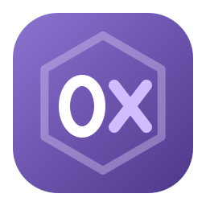
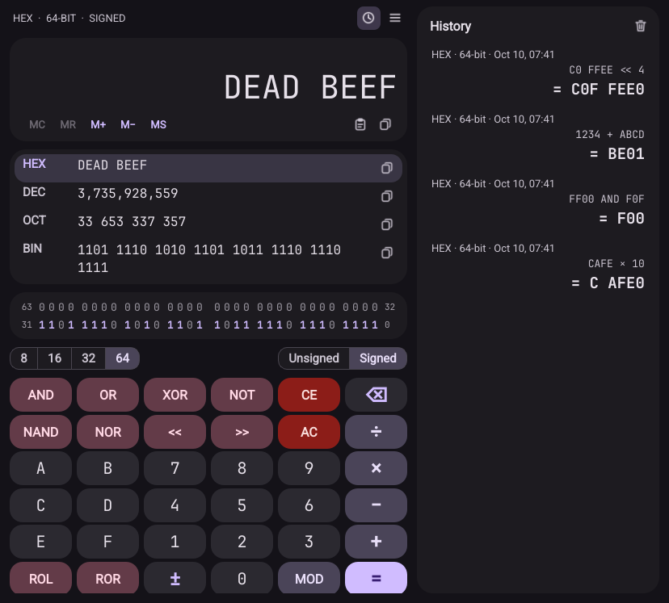
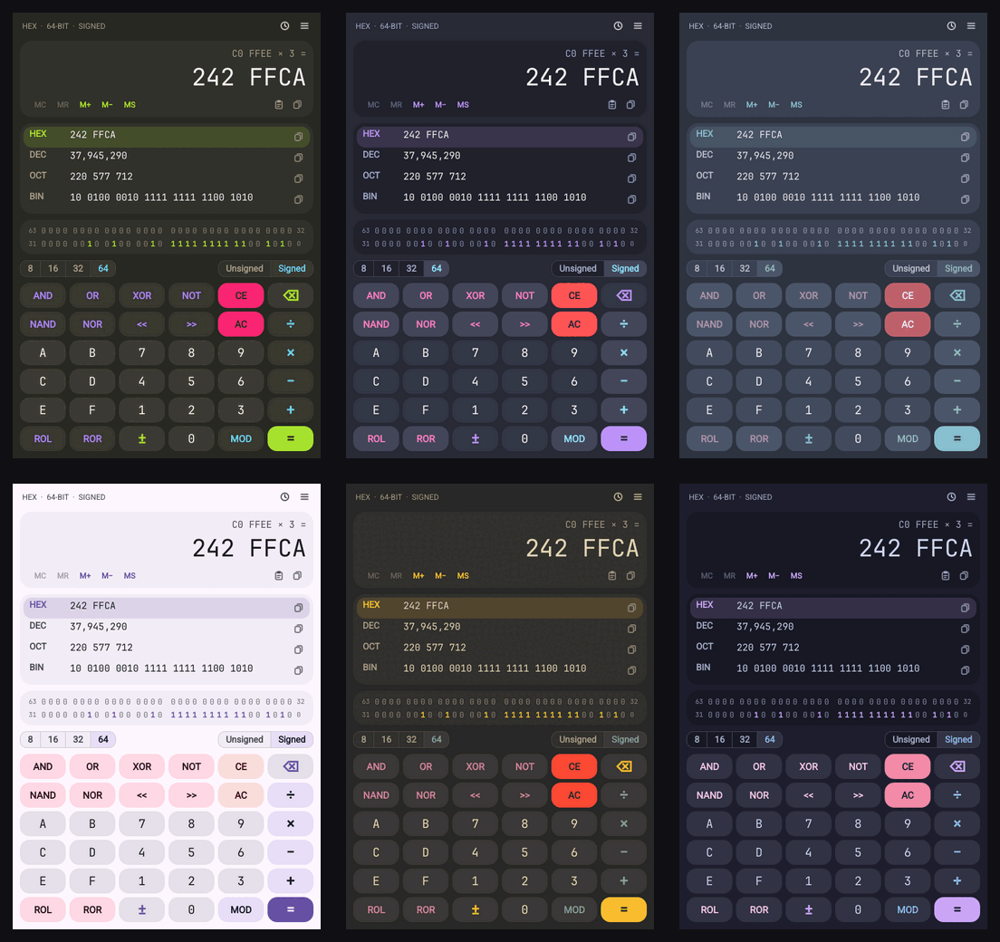
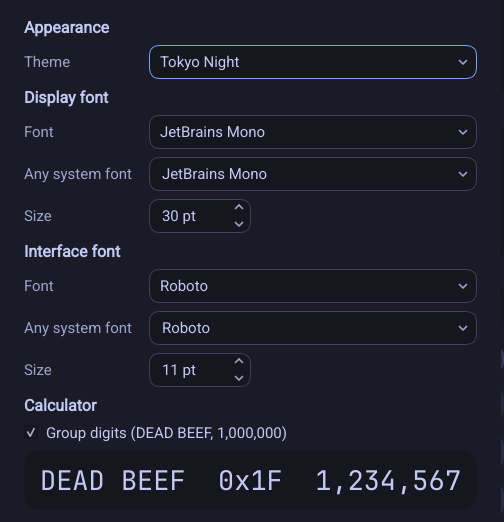

<p align="center">
  
</p>

<h1 align="center">Hex Calc</h1>

<p align="center">
  A fast, themeable programmer's calculator for Linux.<br>
  Hex, decimal, octal and binary side by side, with bitwise operations, history and a Material look.
</p>

<p align="center">
  <a href="https://github.com/naved124/hex-calc/actions/workflows/build.yml"></a>
  
  
  
</p>

<p align="center">
  
</p>

## Features

- **Four bases at once.** The current value is always shown in HEX, DEC, OCT and BIN. Click a row to switch the input base, or use its copy button to grab that representation.
- **Real word sizes.** 8, 16, 32 or 64-bit (BYTE, WORD, DWORD, QWORD), signed (two's complement) or unsigned. Values wrap exactly like they do in hardware.
- **Programmer operations.** `+ − × ÷ MOD`, `AND OR XOR NOT NAND NOR`, shifts `<< >>` (arithmetic when signed) and rotates `ROL ROR`, plus negate `±`.
- **Interactive bit grid.** Every bit of the value, grouped in nibbles. Click a bit to flip it.
- **History.** Every `=` is saved with its expression, base and word size. Click an entry to reuse the result; right-click to copy or delete it. History is kept between sessions (latest 500 entries).
- **Memory.** `MC MR M+ M− MS`, as on a desk calculator.
- **Clipboard that understands numbers.** Paste `0xFF`, `0b1010`, `0o17`, `#ff00ff`, `1Fh`, `-42` or `1,000,000` and it just works.
- **12 built-in themes.** Material Dark (default), Material Light, Monokai, Dracula, Nord, Solarized Dark/Light, Gruvbox Dark, One Dark, Catppuccin Mocha/Latte and Tokyo Night. There's also a *Follow system* mode that switches between Material light and dark.
- **Popular fonts bundled.** JetBrains Mono, Fira Code, Roboto Mono, Source Code Pro, Ubuntu Mono, Roboto and Inter ship with the app and are loaded privately, so nothing is added to your system fonts.
- **Any system font.** Pick any installed font for the display and the interface, and set their sizes independently.
- **Keyboard first.** Every key on the pad has a keyboard shortcut, and keys flash as you type.
- **Light and fast.** The calculator core is plain C with no dependencies. The interface is native Qt Widgets, so it starts instantly and works on X11 and Wayland.

<p align="center">
  
</p>

## Install

### One-line install

```sh
curl -fsSL https://raw.githubusercontent.com/naved124/hex-calc/main/install.sh | bash
```

The script downloads the source, checks for a compiler, CMake and Qt, and offers to install anything missing with your package manager (it asks first). It then builds Hex Calc and installs it to `~/.local`. No root access is needed, except for installing missing packages.

Afterwards, Hex Calc is in your applications menu, or you can run `hex-calc` from a terminal.

### From a clone

```sh
git clone https://github.com/naved124/hex-calc.git
cd hex-calc
./install.sh
```

### Prebuilt binary

Each tagged version publishes a ready-to-run x86_64 build on the [Releases page](https://github.com/naved124/hex-calc/releases). You can install the latest one without compiling:

```sh
curl -fsSL https://raw.githubusercontent.com/naved124/hex-calc/main/install.sh | bash -s -- --binary
```

Or download `hex-calc-linux-x86_64.tar.gz` yourself, unpack it and run `./install.sh` inside. The binary needs the Qt 6 runtime (`libqt6widgets6`, `qt6-base` or `qt6-qtbase-gui`, depending on the distro); the installer offers to add it if it's missing.

### Installer options

| Option | What it does |
| --- | --- |
| `--binary` | Install the prebuilt release instead of building |
| `--prefix DIR` | Install somewhere else, e.g. `--prefix /usr/local` (uses sudo when needed) |
| `--uninstall` | Remove Hex Calc |
| `--purge` | With `--uninstall`, also delete your settings and history |
| `--no-deps` | Never install packages; only report what is missing |
| `-y`, `--yes` | Don't ask before installing packages |

### Requirements

To build, you need a C and C++ compiler, CMake 3.16+ and Qt 6 (Qt 5.12+ also works). The installer handles these for you, or you can install them yourself:

| Distro | Command |
| --- | --- |
| Ubuntu / Debian / Mint / Pop!_OS | `sudo apt install build-essential cmake qt6-base-dev libgl1-mesa-dev` |
| Fedora | `sudo dnf install gcc gcc-c++ make cmake qt6-qtbase-devel` |
| Arch / Manjaro / EndeavourOS | `sudo pacman -S --needed base-devel cmake qt6-base` |
| openSUSE | `sudo zypper install gcc gcc-c++ make cmake qt6-base-devel` |
| Alpine | `sudo apk add build-base cmake qt6-qtbase-dev` |
| Void | `sudo xbps-install gcc make cmake qt6-base-devel` |

On older releases without Qt 6 (for example Ubuntu 20.04), install `qtbase5-dev` instead; the build picks Qt 5 automatically.

## Building manually

```sh
cmake -S . -B build -DCMAKE_BUILD_TYPE=Release
cmake --build build -j
./build/hex-calc                       # run from the build directory
ctest --test-dir build                 # engine unit tests
cmake --install build --prefix ~/.local
```

CMake options:

| Option | Default | Meaning |
| --- | --- | --- |
| `HEXCALC_QT` | *(newest found)* | Force a Qt major version: `5` or `6` |
| `HEXCALC_BUILD_TESTS` | `ON` | Build the engine unit tests |
| `HEXCALC_WERROR` | `OFF` | Treat compiler warnings as errors |

## Using it

Type numbers and operators straight from the keyboard. The expression line above the display shows the pending operation, and `=` repeats the last operation when pressed again (`5 + 3 = = =` gives 8, 11, 14). Operations are evaluated left to right, as on a desk calculator.

### Keyboard shortcuts

Press **F1** in the app to see these at any time.

| Keys | Action |
| --- | --- |
| `0`–`9`, `A`–`F` | Digits (only those valid in the current base are accepted) |
| `+` `-` `*` `/` `%` | Add, subtract, multiply, divide, remainder |
| `&` `\|` `^` `~` | AND, OR, XOR, NOT |
| `<` `>` | Shift left, shift right |
| `Enter` or `=` | Equals |
| `Backspace` | Delete the last digit |
| `Delete` | Clear entry (CE) |
| `Esc` | Clear all (AC) |
| `F9` | Negate (±) |
| `F5` `F6` `F7` `F8` | Hex, decimal, octal, binary |
| `F12` `F2` `F3` `F4` | 64, 32, 16, 8-bit |
| `Ctrl+S` | Toggle signed / unsigned |
| `Ctrl+C` / `Ctrl+V` | Copy / paste the value |
| `Ctrl+H` | Show or hide history |
| `Ctrl+B` | Show or hide the bit grid |
| `Ctrl+G` | Group digits (`DEAD BEEF`, `1,000,000`) |
| `Ctrl+,` | Preferences |
| `Ctrl+Q` | Quit |

### Themes and fonts

Open the **☰ menu → Theme** to switch themes instantly, or **Preferences** (`Ctrl+,`) for everything else:

<p align="center">
  
</p>

- **Display font** is used for numbers, the keypad digits and the bit grid. Choose one of the bundled monospace fonts, *System monospace*, *System default*, or any installed font from *Any system font*.
- **Interface font** is used for labels and menus. Roboto, the Material font, is the default.

You can also start with a theme from the command line:

```sh
hex-calc --list-themes
hex-calc --theme dracula
```

## Files

| Path | Contents |
| --- | --- |
| `~/.config/hex-calc/settings.ini` | Theme, fonts, base, word size, window size |
| `~/.config/hex-calc/history.tsv` | Calculation history (plain text, one entry per line) |
| `~/.local/share/hex-calc/` | Bundled fonts and icons (when installed to `~/.local`) |

## Uninstall

```sh
./install.sh --uninstall           # or: curl -fsSL .../install.sh | bash -s -- --uninstall
./install.sh --uninstall --purge   # also delete settings and history
```

## Project layout

```
src/engine.c, engine.h    calculator core in plain C (no dependencies)
src/mainwindow.*          main window: display, bit grid, keypad, history
src/preferences.*         preferences dialog
src/themes.*              colour themes -> Qt palette and style sheet
src/settings.*, history.* persistence
src/icons.*               line icons drawn in code (follow the theme colours)
tests/test_engine.c       engine unit tests
assets/                   icon, desktop entry, bundled fonts
install.sh                installer / uninstaller
```

## License

Hex Calc is released under the [MIT License](LICENSE).

The bundled fonts keep their own licenses, which are included next to them in [`assets/fonts`](assets/fonts):

- **SIL Open Font License 1.1:** JetBrains Mono, Fira Code, Roboto Mono, Source Code Pro, Roboto, Inter
- **Ubuntu Font Licence 1.0:** Ubuntu Mono
